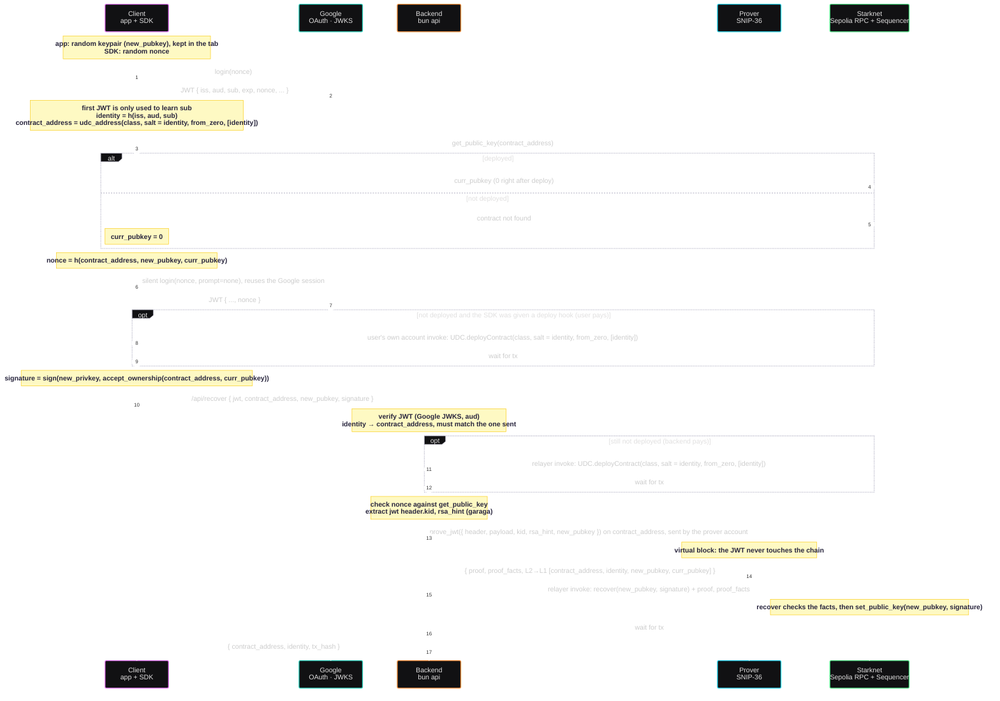

# Design

## Notes

- **Who pays.** The UDC address depends only on class, salt and calldata, so anyone may deploy. The SDK takes an optional `deploy` hook for the user's own account; without it the backend's relayer deploys inside `/recover`. The relayer also submits `recover`. It is a separate funded account, not the registry owner.
- **The signature.** OpenZeppelin's `set_public_key` requires the new key to sign `accept_ownership(contract_address, curr_pubkey)`. Only the client holds the new private key, so the client signs and the backend forwards it.
- **POC escape hatch, `PROVER_MODE=onchain`.** The prover cannot run garaga's builtins yet. In this mode the relayer sends `prove_jwt` as a real transaction instead of proving it. The contract records `h(new_pubkey, curr_pubkey)` and a `recover` without proof facts consumes that record once. Same checks, but the JWT and the Google `sub` become public calldata. The contract refuses this path on `SN_MAIN`.
