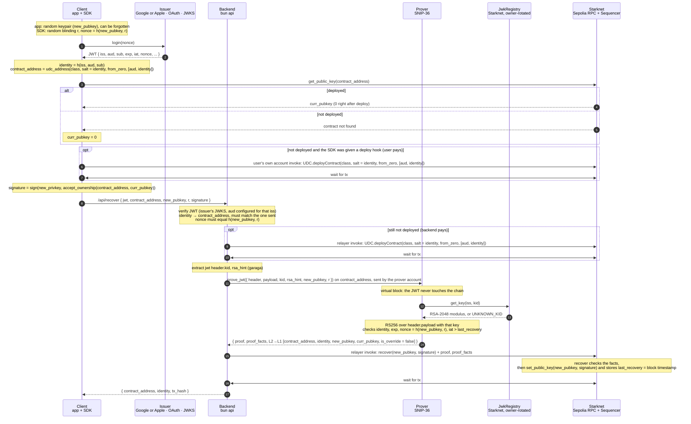
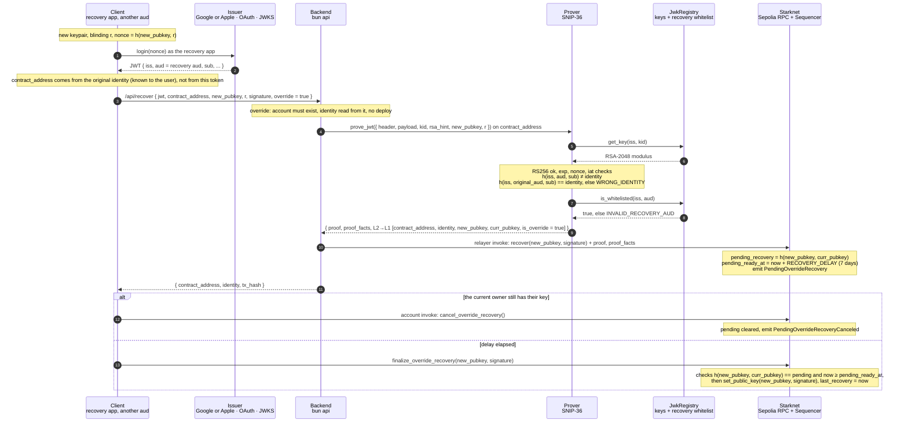

# Social Account

This project explores social login (with OIDC) on Starknet leveraging SNIP-36 local proving.

## Design

A user can generate ephemeral keypairs and recover their account by proving they are the legitimate owners of the JWT signed by OIDC issuers. Two issuers are supported: Google (`iss: https://accounts.google.com`) and Apple (`iss: https://appleid.apple.com`). Adding another means a new `Issuer` variant in `social_account/src/jwt/types.cairo` and an entry in `ISSUERS` in `backend/src/jwk/verification.ts`.

Both run the same implicit flow: the browser is redirected to the issuer and the ID token comes back in the callback's URL fragment. Apple only allows that as `response_type=code id_token` with `response_mode=fragment` and no scope (a scope forces `form_post`). The authorization code that comes along is ignored. Apple's server-side code exchange (`/auth/token`, with a client secret signed by an Apple private key) is not used: it yields the same ID token and the backend never needs an Apple key.

### Features

1. Ephemeral keys can be used to sign transactions. The client dApp / wallet can chose to store those keys and continue transacting like in normal flows, but not needing to ask the user to remember a seed phrase or carry a hardware wallet. The user can recover their account (if the keys are lost) at any time.
2. JWT keys are verified through a `JWKRegistry`, keyed per issuer, which gets updated by the latest changes on the public keys the issuers rotate.
3. Any dApp or wallet can create its own OAuth client at a supported issuer (a Google client ID, an Apple Services ID) so as to issue such tokens, without needing to deploy a different contract.
4. The logic is handled by a `SocialComponent` which theoritically can be plugged into any account contract.
5. JWT can be verified off chain, masking user's data, leveraging SNIP-36 and verify on-chain that the recovery is legitimate.
6. In case of vendor locking (a dApp or wallet shuts down their client id), the user can utilize the "recovery override" method that allows whitelisted `aud`s to issue valid JWTs. See [recovery override](#recovery-override) section.
7. A blinding value "hides" the public key from the issuer, so the issuer cannot link the token to a recovery. The `nonce` signed is `h(pubkey, blinding_value)`. Currently it needs (8) to hide the address.
8. WIP: A (pepper) service hides the identity of the user and cannot tie them to an account address. Currently for the POC the identity of the user on chain is calculated as `identity = h(iss, aud, sub)`, which allows anyone who knows the user's `sub` compute their address and link to their activity on chain. A pepper service holding a VUF key is used to provide a pepper which "anonymizes" the identity as `h(iss, aud, sub, pepper)`.


### Flow
* User creates an ephemeral key pair
* A `nonce` is generated based on a blinding value and the public key `h(public_key, blinding_value)`
* The user is redirected to the issuer's login flow where they are signing the `nonce`.
* A JWT (as `header.payload.signature`) returned containing details about the issuer (`iss`), the dApp (`aud`) and the user (`sub`). Other properies like issued time (`iat`) and expiration (`exp`) are also used.
* The identity is generated (currently with) `identity = h(iss, aud, sub)` (See (8) for details about pepper).
* A contract address can be calculated as `contract_address = udc_address(class, salt = identity, from_zero, [aud, identity])`. This makes the address derivable solely (for now) the identity and allows for deterministic derivation. A dApp or wallet can choose to derive this contract address via a derivation function for providing more than one accounts. This POC doesn't provide this functionality yet.
* The current `public_key` tied to this contract address must be retrieved. Either an existing one from a deployed account or `0x0` if the account is not yet deployed. This key is one (of others) mechanism that prevents a replay attack.
* The account must be deployed. (This is crucial for the proving service to find this account on chain). A relayer should be used.
* A signature is generated from the private key that was generated. This allows the `ownable` component to authorize the change to the new public key later after the proving. The signature is `sign(new_privkey, accept_ownership(contract_address, curr_pubkey))`
* The client sends everything to the backend: the JWT, the `contract_address`, the new `public_key`, the blinding value and the signature.
* The backend verifies the JWT against the issuer's public keys and checks that the `aud` is the one configured for that `iss`. It derives the identity and the `contract_address` on its own and they must match the ones the client sent. The `nonce` in the JWT must equal `h(public_key, blinding_value)`.
* If the account is still not deployed, the backend's relayer deploys it. The relayer is a funded account that pays for the deployment and later for the recovery.
* The backend reads the `kid` from the JWT header and prepares a hint for the RSA check (via garaga). The `kid` tells the contract which of the issuer's rotating keys signed the token.
* The backend asks the prover to run `prove_jwt` on the account. This runs in a virtual block, so the JWT is never submitted on chain. Inside, the contract fetches the key for this `iss` and `kid` from the `JWKRegistry`, verifies the RSA signature over `header.payload`, and checks the identity, the expiration, the `nonce` and that `iat` is newer than the last recovery.
* The prover returns a proof and the facts about what was executed. Among them is a message that pins `contract_address`, `identity`, the new `public_key`, the current `public_key` and whether this was an override recovery.
* The relayer submits `recover(public_key, signature)` with the proof attached. The contract checks the facts match the expected message, sets the new `public_key` using the signature and stores the block timestamp as the last recovery.
* The backend returns the `contract_address`, the `identity` and the transaction hash to the client. The client can now sign transactions with the new key.



### Recovery override

<details>
<summary>Recovery override: a whitelisted aud recovers an account created under another aud. </summary>
 
The goal is to avoid vendor locking if a vendor (the `aud` of the token) decides to take down the client id.

The account is generated with an identity comprised of `h(iss, aud, sub)`, which locks the identity to the originating `aud` (app). So in oder to allow for an escape hatch , in case of vendor locking, the original `aud` is stored along side the `indentity` as `original_aud`.

Then in the case of a user wanting to recover their account, due to vendor shuting down their app, they can use a whitelisted `aud` app provided by SNF (or other) as an escape hatch. This "recovery override" can work by replacing the jwt's `aud` with the `original_aud` and deriving the same identity. Then the new `aud` can be cross referenced from `JWKRegistry`'s whitelisted `aud` by `iss`.


</details>


> [!NOTE]
> The SNIP-36 prover refuses the `RangeCheck96`, `AddMod` and `MulMod` builtins that garaga's `core::circuit` RSA check compiles to, so `social_account/src/jwt/rsa.cairo` re-implements that check with plain field arithmetic (garaga is kept for its types and the hint format). With it the flow runs end to end on Sepolia: `prove_jwt` is proven locally and `recover` carries the proof. The sequencer charges a flat 75M L2 gas per proof and caps the decoded proof at 480,000 bytes; the api logs each proof's size.

## Setup

What you need installed and configured to run the flow end to end on Sepolia.

### Tools

| Tool | Version | Used for |
|---|---|---|
| [scarb](https://docs.swmansion.com/scarb/) | 2.20.1 (see `.tool-versions`) | Builds the Cairo contracts |
| [snforge](https://foundry-rs.github.io/starknet-foundry/) | 0.64.0 | Runs the Cairo tests |
| [bun](https://bun.sh/) | 1.x | Backend services, scripts, tests and the client dev server |
| Docker | any recent | Runs the SNIP-36 prover (and optionally the api and rotator) |

The prover needs about 18 GB of memory for one proof. On Docker Desktop raise the memory slider before starting it.

### Accounts and keys

Three funded or unfunded Starknet accounts on Sepolia, plus an OAuth client per issuer.

| What | Needs STRK | Role |
|---|---|---|
| Owner | yes | Deploys and owns the `JwkRegistry`, pays for key rotations and whitelist changes |
| Relayer | yes | Deploys social accounts through the UDC and submits `recover` |
| Prover account | no, never fund it | Signs the virtual `prove_jwt` transaction. Keep the key private anyway |
| Google OAuth client | n/a | A Web client in the Google Cloud console with `http://localhost:5173/callback` as an authorized redirect URI. Its client ID is the `aud` |
| Apple Services ID | n/a | A Services ID in the Apple developer portal, linked to a primary App ID with Sign in with Apple, with the site's domain and `https://<domain>/callback` registered as a return URL. Apple refuses `localhost` and plain http, so local development needs a tunnel. The Services ID is the `aud` |

### Backend

```sh
cd backend
bun install
cp .env.example .env.local   # fill in the secrets listed above
```

`.env.local` holds `RPC_URL`, the owner, relayer and prover account keys and `PROVER_URL`. `.env` is committed and holds `AUTHORIZED_GOOGLE_RECOVERY_CLIENT_ID`, `AUTHORIZED_APPLE_RECOVERY_CLIENT_ID`, `SOCIAL_ACCOUNT_CLASS_HASH` and the registry address per chain. The two deploy scripts write to it.

Then, in order:

```sh
bun run declare:social-account   # builds and declares SocialAccount, writes SOCIAL_ACCOUNT_CLASS_HASH
bun run deploy:registry          # builds and deploys JwkRegistry, seeds AUTHORIZED_GOOGLE_RECOVERY_CLIENT_ID / AUTHORIZED_APPLE_RECOVERY_CLIENT_ID as recovery auds, writes <CHAIN>_REGISTRY_ADDRESS
bun run rotate:once              # copies Google's and Apple's current RS256 keys into the registry
```

Declaring the account class costs tens of STRK because of the RSA code.

The account pins the registry at `JWK_REGISTRY_ADDRESS` in `social_account/src/social/component.cairo`. To keep that constant valid everywhere, the registry is deployed with a fixed salt, `unique: false` and only the owner in the constructor calldata, so its address depends on nothing but the class hash, the salt and the owner. Deploying with the same owner on another chain lands on the same address. The address only moves if the registry class or the owner changes, and then the constant must be updated and the account declared again.

Start the services:

```sh
bun run service:prover   # docker, local mode only
bun run service:api      # http://localhost:3000
bun run service:rotator  # one loop per issuer, keeps the registry in sync with their key rotation
```

Or all three in Docker with `bun run services:up`.

### Client

```sh
cd client
bun install
cp .env.example .env.local   # fill in the RPC URL and, for Apple logins, the tunnel URL
bun run dev              # http://localhost:5173
```

Apple only redirects to https on a registered domain, so Apple logins need a tunnel. Add `TUNNEL_URL=https://<your-static-domain>` to `.env.local`, register that domain and `https://<your-static-domain>/callback` on the Services ID, then run `bun run client:up` (dev server plus `ngrok http 5173` on that URL) and open the tunnel URL instead of localhost.

`.env` is committed and holds the Google client ID, the Apple Services ID (optional, the Apple button is disabled without it), the API URL and the account class hash. Keep the class hash in sync with `backend/.env` after a new declaration.

### Local proving assets

`client/public/prover/` vendors the browser SNIP-36 prover from [starknet-innovation/snip-36-prover-wasm](https://github.com/starknet-innovation/snip-36-prover-wasm) (Apache-2.0; its `LICENSE` and `THIRD_PARTY_NOTICES.md` are kept next to the files). The three wasm modules (222 MB: executor, standard prover, memory prover) are release assets, not committed: `cd client && bun run prover:assets` downloads them and checks size and sha256 against `manifest.json`.

### Tests

```sh
cd social_account && snforge test
cd backend && bun test
cd client && bun test
```
