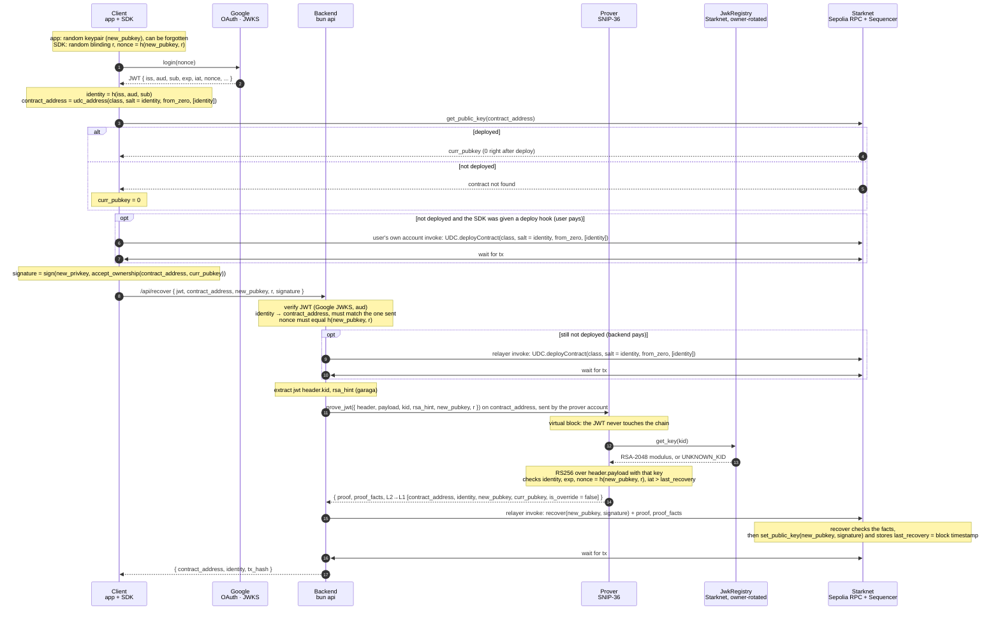
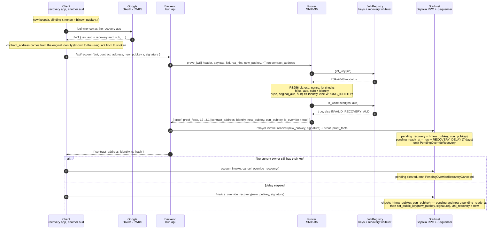

# Social Account

This project explores social login (with OIDC) on Starknet laveraging SNIP-36 local proving.

## Design

A user can generate ephemeral keypairs and recover their account by proving they are the legitimate owners of the JWT signed by OIDC issuers. Currently this flow is experimented under 
`iss: https://accounts.google.com/`.

### Features

1. Ephemeral keys can be used to sign transactions. The client dApp / wallet can chose to store those keys and continue transacting like in normal flows, but not needing to ask the user to remember a seed phrase or carry a hardware wallet. The user can recover their account (if the keys are lost) at any time.
2. JWT keys are verified through a `JWKRegistry` which gets updated by the latest changes on the public keys the issuers rotate.
3. Any dApp or wallet can create a Google Client ID so as to issue such tokens, without needing to deploy a different contract.
4. The logic is handled by a `SocialComponent` which theoritically can be plugged into any account contract.
5. JWT can be verified off chain, masking user's data, leveraging SNIP-36 and verify on-chain that the recovery is legitimate.
6. In case of vendor locking (a dApp or wallet shuts down their client id), the user can utilize the "recovery override" method that allows whitelisted `aud`s to issue valid JWTs. See [recovery override](#recovery-override) section.
7. A blinding value "hides" the public key from the issuer, so the issuer cannot link the token to a recovery. The `nonce` signed is `h(pubkey, blinding_value)`. Currently it needs (8) to hide the address.
8. WIP: A (pepper) service hides the identity of the user and cannot tie them to an account address. Currently for the POC the identity of the user on chain is calculated as `identity = h(iss, aud, sub)`, which allows anyone who knows the user's `sub` compute their address and link to their activity on chain. A pepper service holding a VUF key is used to provide a pepper which "anonymizes" the identity as `h(iss, aud, sub, pepper)`.

### Flow
* User creates an ephemeral key pair
* A `nonce` is generated based on a blinding value and the public key `h(public_key, blinding_value)`
* The user is redirected to the issuer's login flow where they are signing the `nonce`.
* A JWT (as `header.payload.signature`) returned containing details about the issuer (`iss`), the dApp (`aud`) and the user (`sub`). Other properies like issued time (`iat`) and expiration (`exp`) are also used.
* The identity is generated (currently with) `identity = h(iss, aud, sub)` (See (8) for details about pepper).
* A contract address can be calculated as `contract_address = udc_address(class, salt = identity, from_zero, [identity])`. This makes the address derivable solely (for now) the identity and allows for deterministic derivation. A dApp or wallet can choose to derive this contract address via a derivation function for providing more than one accounts. This POC doesn't provide this functionality yet.
* The current `public_key` tied to this contract address must be retrieved. Either an existing one from a deployed account or `0x0` if the account is not yet deployed. This key is one (of others) mechanism that prevents a replay attack.
* The account must be deployed. (This is crucial for the proving service to find this account on chain). A relayer should be used.
* A signature is generated from the private key that was generated. This allows the `ownable` component to authorize the change to the new public key later after the proving. The signature is `sign(new_privkey, accept_ownership(contract_address, curr_pubkey))`
* The client sends everything to the backend: the JWT, the `contract_address`, the new `public_key`, the blinding value and the signature.
* The backend verifies the JWT against Google's public keys and checks that the `aud` is the expected one. It derives the identity and the `contract_address` on its own and they must match the ones the client sent. The `nonce` in the JWT must equal `h(public_key, blinding_value)`.
* If the account is still not deployed, the backend's relayer deploys it. The relayer is a funded account that pays for the deployment and later for the recovery.
* The backend reads the `kid` from the JWT header and prepares a hint for the RSA check (via garaga). The `kid` tells the contract which of Google's rotating keys signed the token.
* The backend asks the prover to run `prove_jwt` on the account. This runs in a virtual block, so the JWT is never submitted on chain. Inside, the contract fetches the key for this `kid` from the `JWKRegistry`, verifies the RSA signature over `header.payload`, and checks the identity, the expiration, the `nonce` and that `iat` is newer than the last recovery.
* The prover returns a proof and the facts about what was executed. Among them is a message that pins `contract_address`, `identity`, the new `public_key`, the current `public_key` and whether this was an override recovery.
* The relayer submits `recover(public_key, signature)` with the proof attached. The contract checks the facts match the expected message, sets the new `public_key` using the signature and stores the block timestamp as the last recovery.
* The backend returns the `contract_address`, the `identity` and the transaction hash to the client. The client can now sign transactions with the new key.

### Recovery override

Recovery override: a whitelisted aud recovers an account created under another aud. 

 
The goal is to avoid vendor locking if a vendor (`aud` in Google's terms) decides to take down the client id.

The account is generated with an identity comprised of `h(iss, aud, sub)`, which locks the identity to the originating `aud` (app). So in oder to allow for an escape hatch , in case of vendor locking, the original `aud` is stored along side the `indentity` as `original_aud`.

Then in the case of a user wanting to recover their account, due to vendor shuting down their app, they can use a whitelisted `aud` app provided by SNF (or other) as an escape hatch. This "recovery override" can work by replacing the jwt's `aud` with the `original_aud` and deriving the same identity. Then the new `aud` can be cross referenced from `JWKRegistry`'s whitelisted `aud` by `iss`.

> [!CAUTION]
> SNIP-36 local proving does not work end to end yet. `prove_jwt` runs inside the prover and stays within the gas limit, but the proof it produces cannot be posted to Starknet. The RSA check relies on garaga builtins that the proving pipeline does not support yet. Until it does, the flow is exercised with `PROVER_MODE=onchain`, where `prove_jwt` runs as a real transaction on testnet, which makes the JWT and the user's `sub` public calldata. **The contract refuses this mode on mainnet**. The builtins in question are `AddMod`, `MulMod` and `RangeCheck96`, which garaga's `core::circuit` based modular arithmetic compiles to.
